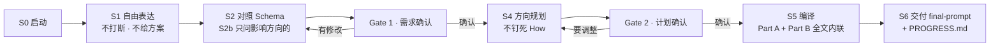

# wenda · 长任务编程需求初始化器（wenda_long-task-prompt）

把用户模糊的项目想法，通过 **需求采访 → 需求确认 → 项目规划 → Context 编译**，
编译成长任务 Coding Agent 能直接开工使用的初始化上下文（一份全文内联的 final-prompt + 一份 PROGRESS.md）。

> 本项目不做代码生成、不是 Coding Agent 本身；它只负责 Coding Agent **开工之前**的那一步：
> 把"你脑子里的事"变成"Agent 手里的合同"。纯 Markdown 工作包，无需安装任何东西。

---

## 它解决什么问题

把一个模糊想法直接丢给长任务 Coding Agent，常见的失败模式与对应机制：

| 失败模式 | 对应机制 | 落点 |
|---|---|---|
| **需求含糊**：Agent 脑补关键意图，做出来的不是你要的 | 先自由表达、再只问"能改变方向"的问题的采访流程 | `m0/prompts/interview-prompt.md` + `m0/requirement-schema.md` |
| **验收主观**："做得好用一点"无法对照，退化成"作者觉得像" | 采访时钉死验收锚点（参考物 / 输入工具链 / 对账分母） | Schema §3b/§6 + 编译器自检 |
| **中途漂移**：长任务跨多轮会话，忘了原始意图、偷偷加功能 | 静态上下文（Part B）与动态状态（PROGRESS.md）分离 + 阶段回读 | `m0/templates/` |
| **假完成**：Agent 宣布"做完了"，但没有可验证的证据 | Iron Law：没有新鲜验证证据，不得宣称完成 | Part A §4 + PROGRESS §4 |

## 工作流程



两个 **Human Gate**（需求确认、计划确认）未通过不得向下。状态机细节（进入条件 / 回退规则 / 各状态纪律）见 [`m0/state-machine.md`](m0/state-machine.md)。

## 快速开始

你不需要安装任何东西。找一个能读写文件的主 Agent（任何主流模型均可）：

1. 对它说："我们来做一个长任务项目的需求初始化。先读 `m0/` 下的 state-machine.md、requirement-schema.md、prompts/interview-prompt.md。"
2. 你自由讲项目想法，它不打断、不给方案；讲完后对照 Schema，只追问真正影响方向的问题。
3. 它给你一份"我理解你的项目是……"，你确认（Gate 1）；然后出一份方向级计划，你确认（Gate 2）。
4. 它按 [`m0/compiler.md`](m0/compiler.md) + [`m0/templates/`](m0/templates/engineering-instructions.md) 编译出**全文内联**的 final-prompt，并初始化一份 PROGRESS.md 随包交付。
5. 把 final-prompt 交给下游长任务 Coding Agent 开工；它以 PROGRESS.md 维护进度与决策。

## 仓库结构

```
m0/                                  核心工作包
├── requirement-schema.md            需求字段模板 + 完成度自检（每个字段标注"缺失会改变什么决策"）
├── state-machine.md                 S0→S6 状态机：进入条件 / 行为 / 两个 Human Gate / 回退规则
├── prompts/
│   ├── interview-prompt.md          S0–S3：自由表达 → 模板检查 → 追问 → 需求确认
│   └── planning-prompt.md           S4：方向级规划（规模路径声明，不钉死 How）
├── templates/
│   ├── engineering-instructions.md  Part A：Agent 怎么工作（V1.1 含测试纪律 / 质量门槛 / 评审协议）
│   ├── project-context.md           Part B：在做什么 / 不能做什么
│   ├── progress.md                  PROGRESS.md 六节结构（决策 / 验证证据 / 收尾检查）
│   └── final-prompt.md              Part A + Part B 组装骨架（必须全文内联）
└── compiler.md                      S5 编译规则 + 自检清单

references/                          13 个领域工程清单（编译时按需勾选、随包交付）
docs/iteration-log.md                设计迭代记录：真实案例反馈 → 机制回写的全过程
```

## 设计取舍

- **先让用户说，再让系统问**：自由表达阶段不套模板。
- **每个问题都必须能改变项目方向**：否则不问（防问卷化）。
- **人定 Why / What / Constraints，Agent 定 How**：Hard / Soft 约束分开。
- **不以自我声明为完成依据**：完成前必须有可观测验证。
- **以"跑通一次真实闭环"为完成标准**，不是"写完模板"。

## 验证情况

- **Dogfooding**：用本项目自身完整跑通 S0→S6（把规划文档当作用户"自由表达原文"），产出全套工作包。
- **真实案例**：多个真实项目完成"Context → 下游真实现"全程闭环，包括 BIM 网页查看器、Revit 构件空间双向导出插件（真实 Revit 2021 实测）、Revit DWG 编码识别插件、代码中文翻译器、简历优化 skill 等；下游逐项核验证明"工具链钉死、验收锚点枚举化"等机制真实拦截了对应类别的缺陷。
- 每一轮"暴露什么缺口、回写到哪一层"的完整记录见 [`docs/iteration-log.md`](docs/iteration-log.md)。

## 设计灵感

本项目为原创方法论：不含任何第三方代码或文本，全部文件为原创写作。以下开源项目的**机制思想**影响了设计（取思想、非 Fork）：

- **spec-kit**：规划前消歧、收尾回归原始意图
- **agents.md**：项目级 Agent 操作指令的结构
- **ralph / dotplan**：短生命周期 Agent + 外部持久状态；静态上下文与动态状态分离
- **autoeng / cadence**：IMPLEMENT→REVIEW→VERIFY→REPLAN 循环；"说做完了"≠"验证通过"
- **pi-gauntlet**：最终实现对照原始意图（防 Scope Drift）
- **Blueprint / plan2agent / goal-prompt**：Plan→Agent 衔接、Human Gate、只问影响目标的问题
- **superpowers / agent-skills 系列技能**：TDD 纪律、系统化排障、评审分级、集成决策权在人

## License

[MIT](LICENSE)
